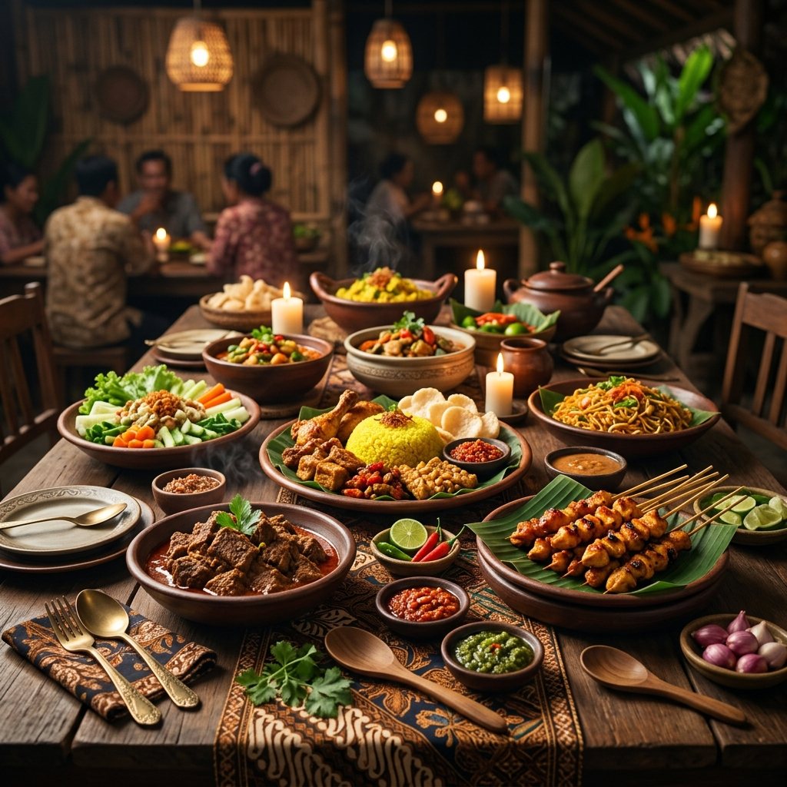

<div align="center">

# 🍲 Jelajah Kuliner Nusantara

Website sederhana untuk mengenal hidangan khas Indonesia—dibuat sebagai tugas akhir kelas **Belajar Dasar Pemrograman Web Dicoding**.



<br>


</div>

## Tentang proyek

**Jelajah Kuliner Nusantara** menampilkan cerita singkat dan keunikan tiga hidangan Indonesia: rendang, gudeg, dan soto Lamongan. Halaman ini dibangun menggunakan HTML, CSS, dan JavaScript tanpa framework maupun dependensi tambahan.

## Fitur

- Tata letak responsif dengan Flexbox dan menu navigasi untuk perangkat mobile.
- Tema terang/gelap yang tersimpan di browser.
- Tombol suka pada setiap artikel.
- Bagian profil penulis dan tautan ke profil Dicoding.
- Tahun hak cipta yang diperbarui secara otomatis.

## Menjalankan secara lokal

Tidak perlu memasang dependensi. Buka `index.html` langsung di browser, atau jalankan server lokal dari folder proyek:

```bash
python -m http.server 8000
```

Kemudian kunjungi <http://localhost:8000>.

## Struktur proyek

```text
.
├── assets/
│   └── images/       # Foto hero, profil, dan hidangan
├── scripts/
│   └── main.js       # Interaksi halaman
├── styles/
│   └── style.css     # Gaya dan layout responsif
├── index.html
└── README.md
```

## Kriteria pembelajaran

Halaman menggunakan elemen semantik seperti `<header>`, `<nav>`, `<main>`, `<article>`, `<aside>`, dan `<footer>`, serta menerapkan layout Flexbox dan media query.

---

<div align="center">
Dibuat dengan 🧡 untuk belajar web dan merayakan kekayaan kuliner Indonesia.
</div>
